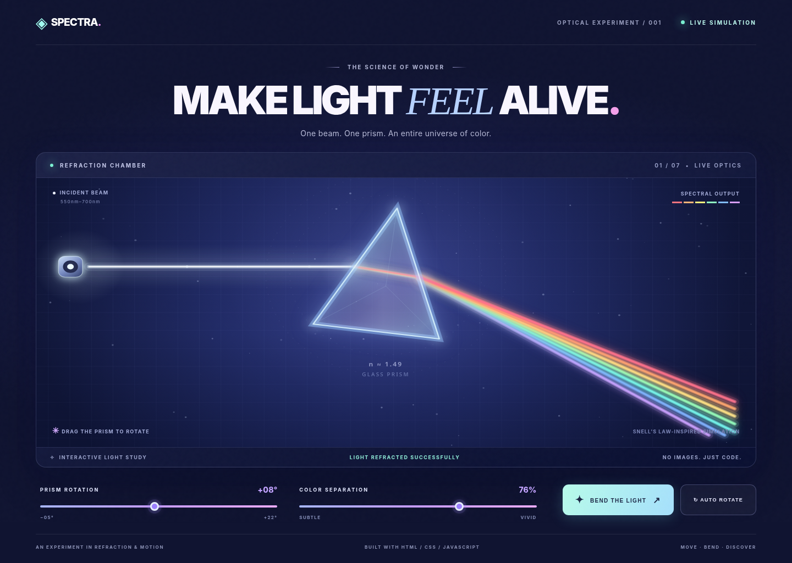

# SPECTRA — Bend the Light

An interactive, cinematic glass-prism experiment built with **HTML, CSS, and vanilla JavaScript Canvas 2D**. A beam of white light enters a triangular prism and exits as a luminous rainbow. Rotate the prism to change the refraction, adjust dispersion, and replay the beam transformation.



## Features

- An actual JavaScript refraction function based on **Snell's law** (vector form)
- Ray–triangle edge intersections determine entry and exit points
- Seven light paths with stylized wavelength-dependent refractive indices
- Drag the prism or adjust the angle slider; smooth automatic rotation
- Adjustable rainbow spread and replayable light-splitting animation
- Detailed glass reflections, animated ambient dust, glow and bloom
- Responsive **9:16-friendly layout** for screen-recording reels
- **No frameworks, APIs, assets, external libraries or CDN dependencies**
- Keyboard shortcuts: **R** to reset/replay, **Space** to replay when not focused on a button or slider

**Visual note:** The separation is intentionally enhanced for an eye-catching animation; this is an educational/creative *Snell's-law-inspired simulation*, not a calibrated scientific optics instrument. A real prism disperses a continuous spectrum.

## Run locally

1. Download/extract the ZIP or clone the GitHub repository.
2. Open `index.html` in your browser. No npm setup is required.
3. For a local development server: `python -m http.server 8000` and open `http://localhost:8000`.
4. Publish by making the repository public and enabling **Settings → Pages** (root branch/folder) on GitHub.

## Controls

| Control | Action |
| --- | --- |
| Drag prism | Rotate it interactively |
| Prism Rotation | Change refraction angle (−5° to +22°) |
| Color Separation | Increase or decrease color spread |
| Bend the Light | Replay the animated light-splitting sequence |
| Auto Rotate | Slowly rotate prism back and forth |

## Project files

```text
SPECTRA-Refraction-Lab/
├── index.html
├── styles.css
├── script.js
├── main-code-snippet.js        # exact 6-line excerpt from script.js
├── README.md
├── SOCIAL_CAPTIONS.md
├── LICENSE
└── previews/
    ├── desktop.png
    ├── mobile.png
    ├── reel.png
    ├── main-code-1080x960.png
    └── reel-split-screen-example.png
```

## The six-line JavaScript snippet

This **exact function** appears in `script.js`. It refracts an incident light direction vector at a surface using two refractive indices, returning null for total internal reflection.

```js
function refractRay(dir, normal, n1, n2) {
  const r = n1/n2, c = -dot(normal, dir);
  const k = 1 - r*r*(1-c*c);
  if (k < 0) return null;
  return normalize(add(mul(dir,r), mul(normal,r*c-Math.sqrt(k))));
}
```

A **1080 × 960** syntax-highlighted PNG is provided at `previews/main-code-1080x960.png` specifically for the lower half of a vertical Reel.

## License

MIT — see [`LICENSE`](LICENSE). You can publish the repository and reuse/adapt the code.
